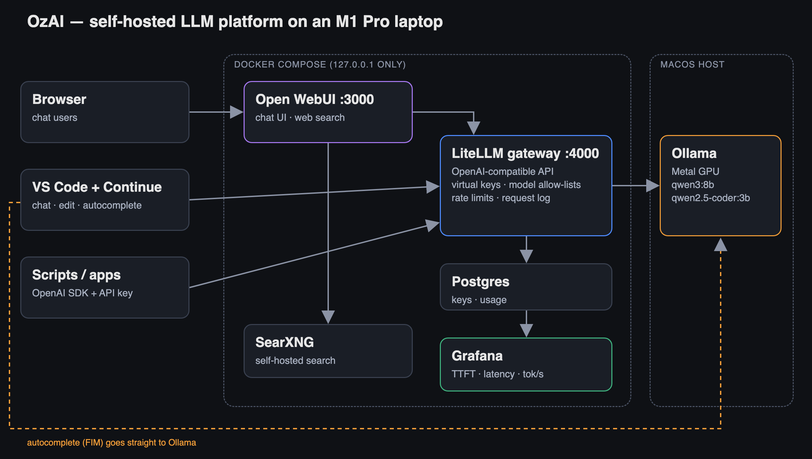
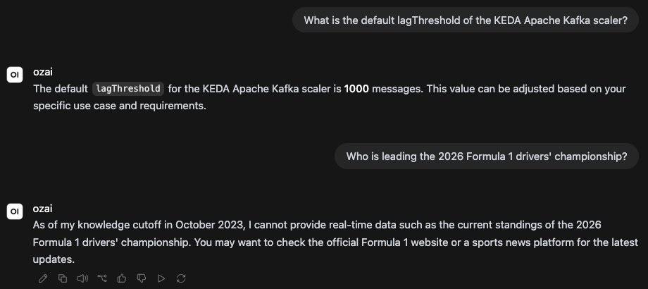

# I Built a Self-Hosted ChatGPT on My Laptop. Here's What Broke.

*From DevOps to AI Platform Engineering — Part 1*

I'm a DevOps engineer. I've spent years running Kubernetes clusters, writing Terraform and keeping production alive. Lately, every job interview has a new question in it: *"What have you done with AI?"*

Calling the OpenAI API from a script didn't feel like a good answer. So I set myself a different goal: **run an open-weight LLM myself and serve it to other people like a real platform**, with API keys, rate limits, usage tracking and numbers I measured myself.

This is part 1 of a 4-part series. Everything here runs on one laptop, a MacBook Pro M1 Pro with 16 GB of RAM. Part 2 covers observability and load testing, part 3 covers RAG, and part 4 moves the same platform to GPUs on Amazon EKS.

I call the platform **OzAI**. To be clear from the start: OzAI is *not* a model I trained. It's a self-hosted platform built on open-weight models (Qwen3 8B and Qwen2.5-Coder 3B). The engineering is in serving them.

---

## The architecture



- **Ollama** runs the models. It runs natively on macOS, not in Docker (more on that below).
- **LiteLLM** is the gateway: an OpenAI-compatible API with per-user virtual keys, model allow-lists, rate limits and a request log in Postgres.
- **Open WebUI** is a ChatGPT-style UI that talks only to the gateway.
- **SearXNG** is a self-hosted search engine, so the model can answer questions about recent events.
- **Grafana** shows dashboards built on the gateway's request log (part 2).

Everything except Ollama runs in Docker Compose and binds to `127.0.0.1` only. Nothing is exposed to the internet yet.

**Decision #1: Ollama runs on the host, not in a container.** Docker on macOS runs containers inside a Linux VM with no access to the Apple GPU. Ollama in a container would run on the CPU only. On the host it uses Metal, and the containers reach it at `host.docker.internal:11434`. It looks less tidy in a compose file, but it's the difference between a usable system and an unusable one.

---

## Step 1: How fast is a laptop, really?

Before building anything, I measured. Here is one request per model, 200 max tokens, no concurrency:

```
Model                    Disk     Cold load   Prompt eval   Generation
qwen2.5-coder:3b (Q4)    1.9 GB   2.1 s       120 tok/s     53.3 tok/s
qwen3:8b (Q4_K_M)        5.2 GB   3.9 s        87 tok/s     22.4 tok/s
```

Two things surprised me:

- **The 8B model is less than half as fast as the 3B one.** Generating tokens is limited by memory bandwidth, not compute. For every token, the model's weights have to be read from memory again. A model 2.7× bigger is roughly 2.4× slower.
- **22 tokens per second is fine for one person.** That's faster than most people read. The real question is what happens with more than one user, which comes later.

Quantization (`Q4_K_M` = roughly 4 bits per weight) is what makes an 8B model fit in 5.2 GB at all. Without it, the same model needs around 16 GB just for its weights, which is all the RAM in this laptop.

---

## Step 2: A gateway, not just a model

Running a model is easy. Letting *other people* use it safely is the platform engineering part, and that's where LiteLLM comes in.

The model list maps friendly names to real models:

```yaml
model_list:
  - model_name: ozai            # fast chat
    litellm_params:
      model: ollama_chat/qwen3:8b
      api_base: http://host.docker.internal:11434
      reasoning_effort: none
      num_ctx: 8192
  - model_name: ozai-think      # same model, thinking on
    litellm_params:
      model: ollama_chat/qwen3:8b
      api_base: http://host.docker.internal:11434
      num_ctx: 8192
  - model_name: ozai-coder
    litellm_params:
      model: ollama_chat/qwen2.5-coder:3b
      api_base: http://host.docker.internal:11434
```

Then every client gets its own virtual key with its own limits:

```bash
curl localhost:4000/key/generate \
  -H "Authorization: Bearer $LITELLM_MASTER_KEY" \
  -d '{"key_alias":"demo-friend","models":["ozai"],"rpm_limit":10}'
```

I tested it the way I'd test any API gateway:

```
No key                              -> 401
Friend key asking for ozai-coder    -> 403 (not on its allow-list)
12 requests in a minute, limit 10   -> 9 x 200, then 429
                                       (one earlier request counted in the same window)
```

Any tool that speaks the OpenAI API can now use OzAI by changing two settings: the base URL and the key. That turned out to matter a lot for the IDE integration below.

---

## What broke (the useful part)

Nothing below threw an error. Every one of these problems showed up as "it works, but badly."

### 1. A "thinking" model made every answer take two minutes

Qwen3 is a reasoning model. Before it answers, it writes a hidden chain of thought. One simple question produced over 600 streamed reasoning chunks before the first word of the actual answer. The full response took about two minutes, partly because it was queued behind another request on the same GPU.

There was a second, quieter problem. With a small `max_tokens`, the model spent the whole budget on thinking and **returned an empty answer**.

**Fix:** two aliases for the same weights. `ozai` has thinking turned off (`reasoning_effort: none`) and is the default. `ozai-think` is there for hard questions. Users choose speed or depth by picking a model name. Nobody has to know about prompt flags.

### 2. A $0 budget blocked everything

I gave a test key `max_budget: 0`, assuming that meant "no spending allowed." Local models cost $0, so I expected every request to pass. Instead, every request was rejected:

```
Budget has been exceeded! Current cost: 0.0, Max budget: 0.0
```

The check is `spend >= budget`, and 0 ≥ 0. For self-hosted models, either leave the budget unset or set a custom per-token price so the budget means something.

### 3. The UI was quietly competing with its own users

The chat UI felt slow even with a single user. The gateway log explained why. After every answer, Open WebUI sends *extra* requests to the same model: one to generate a chat title, one for tags, one for follow-up suggestions.

On one GPU, those requests queue in front of the user's next question.

**Fix:** In Open WebUI's admin settings, point background tasks at the small 3B model (`ozai-coder`) and turn off tags and follow-ups. After that, answers started almost immediately again.

### 4. More users don't get more throughput

I wrote a small load generator (Python threads streaming from the gateway) and measured time to first token (TTFT) and throughput at different concurrency levels. Each request asked for 128 tokens:

```
Users   TTFT p50   TTFT max   Per-user tok/s   Total tok/s
1         0.3 s      0.3 s        19.5            19.5
2         3.4 s      6.7 s        14.5            19.7
4         9.3 s     18.6 s         8.7            20.8
8        21.3 s     43.3 s         4.7            20.7
```

**Total throughput stays flat at about 20 tokens per second.** More users just split the same output into smaller slices. The worst TTFT is roughly *your place in the queue × one answer*. In practice, requests are processed one at a time.

For a DevOps engineer this was the key lesson: **an LLM server does not scale like a web server.** Adding users doesn't use idle capacity, because the hardware is already working at full speed for one request. Production inference servers like vLLM fix this with *continuous batching*, which runs many requests through the model in the same pass. That's part 3.

### 5. The model is confidently wrong, and has no idea what day it is

An 8B model has to compress a lot of world knowledge into 5 GB, and it shows. Ask it a precise technical question and it answers with total confidence, even when it's wrong. The KEDA Kafka scaler's default `lagThreshold` is **10**. OzAI says **1000**:



The second answer shows the other limit. The model only knows what was in its training data, and it reports a knowledge cutoff of October 2023. The current F1 season is out of reach.

Both problems have the same cure: stop relying on what the model remembers, and give it the facts at question time. Later in this series I add document RAG and measure it. On 10 KEDA questions like this one, accuracy goes from 1/10 to 8/10.

**Fix (part one of RAG):** web search through a **self-hosted SearXNG** instance. Open WebUI searches, pulls in the relevant parts of the top results and gives them to the model as context. No search API keys, and no queries sent to a third-party AI provider.

It still didn't work. That led to the best bug of the project.

### 6. The bug with no error: silent prompt truncation

Web search was on and SearXNG was returning results. The model still said "I don't have access to live data."

The gateway's request log had the clue. **Every Open WebUI request had exactly 2,050 prompt tokens.** It didn't matter whether the question was short or long, or whether search was on or off.

So I ran a test. I sent about 5,000 tokens of filler text with a secret word at the very end:

```
Sent:   ~5,000 tokens, secret word at the END
Got:    prompt_tokens: 2050, answer: BANANA
```

The model found the word, but the gateway reported only 2,050 prompt tokens. About 3,000 tokens had disappeared, and since the end survived, they came from the beginning. Ollama was silently cutting long prompts to fit its context window. It **kept the end and dropped the beginning**, with no error and no warning. Open WebUI puts the search results at the *start* of the prompt, so they were cut every single time.

**Fix:** one line, `num_ctx: 8192`, on the gateway model. Then I moved the secret word to the *start* of the prompt and repeated the test:

```
Sent:   ~5,000 tokens, secret word at the START
Got:    prompt_tokens: 5430, answer: BANANA
```

The whole prompt now reached the model. Memory use went from 5.6 GB to 6.2 GB.


This is the lesson I'd put on a poster for anyone moving from DevOps to AI infrastructure: **in LLM serving, "no error" doesn't mean "correct."** A web server that drops half a request fails loudly. A model server that drops half a prompt just gives a worse answer. Watch your token counts.

### 7. IDE integration: the gateway was the wrong path for autocomplete

Because the gateway speaks the OpenAI API, connecting VS Code (with the Continue extension) took one config block. Chat and code edits go through the gateway with their own key, so that usage shows up in the logs.

Autocomplete was different. Code completion uses *fill-in-the-middle* (FIM): the model gets the code before and after the cursor and fills the gap. Through the gateway, the coder model answered like a chatbot instead:

```
"Certainly! The Fibonacci sequence is a series of numbers where..."
```

The gateway's completions endpoint was dropping the FIM parameters (`suffix`, `raw`) on the way to Ollama. Called directly, Ollama completed the function correctly:

```python
def fibonacci(n):
    if n <= 1:
        return n
    else:
        return fibonacci(n-1) + fibonacci(n-2)
```

**Fix:** chat goes through the gateway, and autocomplete goes straight to Ollama. That's the dashed line in the architecture diagram. It's a trade-off: autocomplete requests don't appear in the usage logs. For a local setup, I'll take working completions over complete logs.

Cursor is another story. It calls custom models from its own servers, so it can't reach `localhost`. That needs a public, authenticated endpoint, which is coming later with Cloudflare Tunnel and Access.

---

## What I'd tell another DevOps engineer

1. **The gateway is where your skills transfer.** Keys, quotas, rate limits, routing, request logs: this is API platform work you already know. The model is just another upstream.
2. **Measure before you optimize.** One table of tokens per second at 1, 2, 4 and 8 users explained more than any blog post I read.
3. **LLMs fail quietly.** Truncated prompts, empty answers caused by thinking, confident hallucinations. None of them return a 500. Your monitoring has to look at token counts and answer quality, not just status codes.
4. **Small local models are fast and cheap, but not reliable as a source of facts.** Give them context (search, documents) instead of trusting what they remember.

## What's next

- **Part 2: observability and load testing.** A Grafana dashboard for TTFT, latency percentiles and tokens per second, built from the gateway's request log. Plus why LiteLLM's Prometheus metrics weren't an option.
- **Part 3: RAG.** Giving the model my own documents to answer from, measured on a 10-question test: from 1/10 to 9/10.
- **Part 4: from laptop to production.** vLLM on Amazon EKS with GPU nodes, autoscaling on queue depth with KEDA, and the cost of self-hosting compared with paying per token.

All configs, benchmarks and notes are in the repo: **[github.com/ozy31/self-hosted-llm-platform](https://github.com/ozy31/self-hosted-llm-platform)**

*If you're making the same move from DevOps into AI infrastructure, I'd like to hear what surprised you.*
