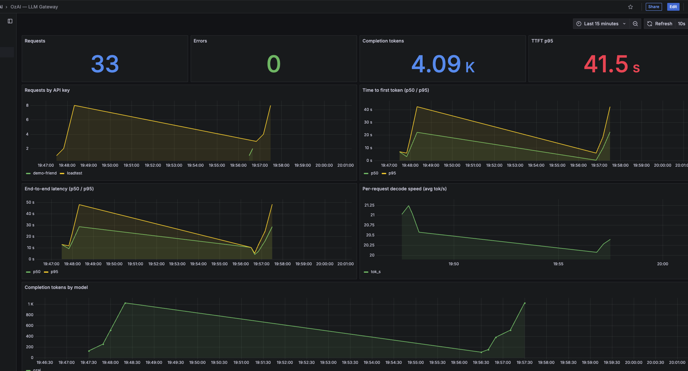

# Your LLM Returns 200 OK and Still Fails. How I Monitor a Self-Hosted Model.

*From DevOps to AI Platform Engineering — Part 2*

In [part 1](https://dev.to/ozy31/i-built-a-self-hosted-chatgpt-on-my-laptop-heres-what-broke-2gci) I built **OzAI**, a self-hosted ChatGPT-style platform on a MacBook Pro M1 Pro with 16 GB of RAM:

- Ollama runs open-weight models (Qwen3 8B, Qwen2.5-Coder 3B).
- A LiteLLM gateway handles API keys and rate limits.
- Open WebUI is the chat interface.

The biggest lesson from part 1 was uncomfortable: **the worst failures returned HTTP 200.** Prompts were silently truncated, answers came back empty because the model spent its whole budget "thinking," and some answers were confidently wrong. None of these showed up as errors.

So this part is about the question every DevOps engineer asks next: *how do I see what's going on?* I'll cover which metrics matter for an LLM, how I built a dashboard without paying for an enterprise license, and what a load test told me about capacity.

---

## Request rate and error rate are not enough

For a normal web API, I'd start with the RED metrics: rate, errors, duration. For an LLM they're necessary but they miss most of the story. A single "duration" number hides two very different phases:

1. **Prefill.** The model reads the whole prompt. This determines **time to first token (TTFT)**, how long the user stares at an empty screen.
2. **Decode.** The model generates the answer one token at a time. This determines **tokens per second**, how fast the text streams.

A 30-second request can be fine (a long answer streaming at full speed) or terrible (29 seconds in a queue, then a short answer). You can only tell them apart if you measure the phases separately.

These are the metrics I settled on:

| Metric | What it tells you |
|---|---|
| TTFT p50 / p95 | Queueing and prompt size. The number users *feel*. |
| Decode tokens/s per request | Is the hardware healthy? Is it shared? |
| End-to-end latency p50 / p95 | Total cost of a request |
| Prompt and completion tokens | Truncation (see part 1), cost, context usage |
| Requests per API key | Who is using the platform |

Token counts are in that list on purpose. In part 1, the only clue to a serious bug was that every request had **exactly 2,050 prompt tokens**. A flat line on a token graph is an alert waiting to be written.

---

## Plan A: Prometheus. It didn't work out.

My DevOps reflex was Prometheus. LiteLLM has a Prometheus integration, so I enabled it:

```yaml
litellm_settings:
  callbacks: ["prometheus"]
```

The `/metrics` endpoint came up, but there were no `litellm_*` metrics in it. It turns out the Prometheus integration is an **Enterprise feature** in LiteLLM. The open-source image accepts the setting and quietly does nothing, which fits the theme of this series.

## Plan B: the gateway already logs every request

LiteLLM writes a row to Postgres for every request, in a table called `LiteLLM_SpendLogs`. It's meant for cost tracking, but it has everything I need:

- `startTime`: the request arrived
- `completionStartTime`: the first token was sent
- `endTime`: the last token was sent
- `prompt_tokens`, `completion_tokens`, `model_group`, `status`
- the API key's alias, inside a JSON `metadata` column

From these three timestamps, the important metrics are just subtraction:

```
TTFT          = completionStartTime - startTime
decode tok/s  = completion_tokens / (endTime - completionStartTime)
```

So the plan became **Grafana reading the request log directly with SQL**.

### A read-only role first

Grafana shouldn't be able to touch the gateway's database. It gets a role that can read one table and nothing else:

```sql
CREATE ROLE grafana_ro LOGIN PASSWORD '...';
GRANT CONNECT ON DATABASE litellm TO grafana_ro;
GRANT USAGE ON SCHEMA public TO grafana_ro;
GRANT SELECT ON "LiteLLM_SpendLogs" TO grafana_ro;
```

The keys table, the users table and the budgets are invisible to Grafana. If the dashboard is ever compromised, the blast radius is a list of timestamps and token counts.

### TTFT percentiles in SQL

Postgres has `percentile_cont`, so percentiles are exact, not estimated from histogram buckets:

```sql
SELECT
  $__timeGroupAlias("startTime", $__interval),
  percentile_cont(0.5)  WITHIN GROUP (ORDER BY extract(epoch FROM "completionStartTime" - "startTime")) AS p50,
  percentile_cont(0.95) WITHIN GROUP (ORDER BY extract(epoch FROM "completionStartTime" - "startTime")) AS p95
FROM "LiteLLM_SpendLogs"
WHERE $__timeFilter("startTime") AND status = 'success'
  AND "endTime" - "completionStartTime" > interval '100 milliseconds'   -- streamed requests only, see below
GROUP BY 1 ORDER BY 1
```

Decode speed works the same way. I also skip very short answers, because dividing a handful of tokens by a few milliseconds produces nonsense:

```sql
SELECT
  $__timeGroupAlias("startTime", $__interval),
  avg(completion_tokens / nullif(extract(epoch FROM "endTime" - "completionStartTime"), 0)) AS tok_s
FROM "LiteLLM_SpendLogs"
WHERE $__timeFilter("startTime") AND status = 'success' AND completion_tokens > 10
  AND "endTime" - "completionStartTime" > interval '100 milliseconds'
GROUP BY 1 ORDER BY 1
```

Requests per API key come from the JSON column: `metadata->>'user_api_key_alias'`.

### Dashboards as code

Nothing is clicked together in the UI. The datasource and the dashboard are provisioned from files in the repo, so `docker compose up` produces the same dashboard every time:

```
grafana/
  provisioning/datasources/litellm.yaml   # Postgres, read-only user
  provisioning/dashboards/ozai.yaml       # "load dashboards from this folder"
  dashboards/ozai-gateway.json            # the dashboard itself
```

One gotcha cost me a restart loop. I first wrote the datasource in compact YAML flow style, with the password as `$__env{GRAFANA_DB_PASSWORD}` inside `{ }`. The braces collide with YAML's own syntax and provisioning fails to parse. Block-style YAML with a plain `$GRAFANA_DB_PASSWORD` works:

```yaml
apiVersion: 1
datasources:
  - name: LiteLLM
    uid: litellm-pg
    type: grafana-postgresql-datasource
    url: postgres:5432
    user: grafana_ro
    jsonData:
      database: litellm
      sslmode: disable
    secureJsonData:
      password: $GRAFANA_DB_PASSWORD
```



### The dashboard had a silent bug too

The first version of the decode speed panel showed a peak of **13,000 tokens per second**, on a laptop that tops out around 22.

The cause was a second API key that sent normal, non-streaming requests. A non-streaming answer reaches the client in one piece, so the gateway logs `completionStartTime` and `endTime` almost at the same moment:

```
key          TTFT      decode time   completion tokens
loadtest     6.37 s    6.38 s        128      <- streamed
demo-friend  5.24 s    0.000 s       100      <- not streamed
```

100 tokens divided by about 0 seconds is a huge number, and one such row ruins the average. These requests also mess up TTFT in a quieter way. Their "time to first token" is really the time for the *whole* answer, so they push the TTFT percentiles up.

The fix is the extra `WHERE` line in both queries above: TTFT and decode speed only count streamed requests, where the two timestamps are meaningfully apart. Request counts, latency and tokens still include everything.

It's the same lesson as part 1, one layer up. Nothing errored. The panel just showed a confident, wrong number. **Check your metric definitions against raw rows before you trust a dashboard.**

---

## Load testing an LLM

Generic HTTP load tools like `ab` or `hey` measure the whole response. To get TTFT you have to **stream** and record the moment the first content token arrives. I wrote a small load generator in plain Python (threads plus `urllib`, no dependencies). It's about 80 lines and lives in the repo as `loadtest/bench.py`.

Each simulated user sends the same prompt ("Explain how Kubernetes Horizontal Pod Autoscaler works.") with `max_tokens: 128` through the gateway, using its own API key. I ran 1, 2, 4 and 8 concurrent users.

### My first result was wrong

```
Users   TTFT p50   TTFT max   Total tok/s
1         0.5 s      0.5 s       18.4
2        57.7 s     60.8 s        3.8     <- ???
4        16.1 s     25.3 s       16.3
8        21.7 s     43.1 s       20.9
```

Two users took longer than eight. The cause was me: **I was chatting in Open WebUI while the test ran**, and as part 1 showed, Open WebUI sends extra background requests (title, tags, follow-ups) after every answer. My own chat was a noisy neighbor on a GPU that can only do one thing at a time. I only figured that out by digging through the gateway's request log by hand.

That's a benchmarking lesson I already knew from web systems, and I still ignored it: **benchmark on an idle system, and make it easy to see who else is using it.** This run is the reason the dashboard has a "requests by API key" panel. With it, the same contamination is visible at a glance: the load-test key and the Open WebUI key show up as separate lines.

### The clean run

On an idle machine:

```
Users   TTFT p50   TTFT max   Latency max   Per-user tok/s   Total tok/s
1         0.3 s      0.3 s        6.6 s          19.5            19.5
2         3.4 s      6.7 s       13.0 s          14.5            19.7
4         9.3 s     18.6 s       24.6 s           8.7            20.8
8        21.3 s     43.3 s       49.1 s           4.7            20.7
```

I ran it again four days later, right after starting the stack, and got almost the same numbers, with one difference:

```
Users   TTFT p50   TTFT max   Total tok/s
1         7.1 s      7.1 s        9.7    <- cold start
2         3.2 s      6.3 s       20.9
4         9.4 s     18.6 s       20.8
8        22.2 s     44.3 s       20.4
```

### What the numbers say

**1. Total throughput is a constant, about 20 tokens per second.** One user, two users, eight users: the hardware produces the same amount of text. More users get thinner slices of it. Decoding is limited by memory bandwidth. Every token requires reading the model's weights from memory, and the GPU is already doing that as fast as it can for one request.

**2. TTFT is a queue.** The worst TTFT is roughly *(your position in the queue) × (time for one answer)*. One 128-token answer takes about 6.5 seconds, so the 8th user waits about 7 × 6.5 ≈ 45 seconds. The measured value was 43–44 seconds. In practice, requests are served one at a time.

**3. Cold starts are real.** In the second run, the first request took 7 seconds to produce a token instead of 0.3. Ollama had just started and had to load 5 GB of weights into memory first. Ollama also unloads an idle model after 5 minutes by default (`keep_alive`), so on a quiet platform *the first user after a break* always pays this price. On a dashboard it shows up as a lone TTFT spike after an idle period. Now I know it isn't an incident.

### Capacity, in DevOps terms

Say the SLO is "TTFT p95 under 5 seconds" for answers of about 128 tokens. With requests served one at a time, this laptop meets that SLO at **one concurrent request**. Two concurrent users already push the second one past 6 seconds.

That doesn't mean only one person can use it. Real users read, type and think between messages, so a handful of people can share it comfortably. But it does mean this setup can't handle a burst, and adding CPU, RAM or replicas on the same machine won't change that. The fix is a different serving engine (continuous batching in vLLM) on different hardware, which is part 3.

---

## What this setup can't see

SQL over request logs gives exact per-request numbers, but it only sees what the gateway sees. It has some blind spots:

- **No queue depth.** I have to infer queueing from TTFT. Ollama doesn't expose how many requests are waiting.
- **No GPU metrics.** No utilization, no memory, no temperature.
- **No KV cache usage.** That's the resource that actually limits concurrency on a real inference server.
- **No alerting yet.** The dashboards are for looking, not paging anyone.

For production, I'd keep the gateway log for per-key usage and add the serving engine's own metrics. vLLM exposes Prometheus metrics natively, including `vllm:num_requests_waiting` and KV cache usage. NVIDIA's DCGM exporter covers the GPU. Those are what I'll use on Kubernetes in part 3, and queue depth is also exactly the signal to autoscale on.

The first alerts I'd write, based on what actually went wrong in this project:

1. TTFT p95 above the SLO for 5 minutes (queueing or cold starts).
2. Error rate above zero for any key (auth, rate limits, budget misconfiguration, like the $0 budget from part 1).
3. **Prompt tokens stuck at the same value across many requests.** It looks strange, but it's the alert that would have caught the silent truncation bug on day one.

---

## Takeaways for DevOps engineers

1. **Split latency into TTFT and decode speed.** One "duration" number hides whether users are waiting in a queue or reading a long answer.
2. **Your gateway's request log is a metrics source.** If Prometheus isn't available, a read-only SQL datasource gives you exact percentiles in an afternoon.
3. **Tag traffic by API key.** A noisy neighbor becomes visible at a glance, instead of after digging through raw logs.
4. **An LLM server's throughput is fixed by the hardware.** Load tests on a single GPU don't find a breaking point. They find a queue, and they tell you how long it gets.

## Next: parts 3 and 4

- **Part 3: RAG.** The model in this series confidently invents facts. Next I give it my own documents to answer from, and measure it on a 10-question test: from 1/10 to 9/10, and why the last failures weren't the model's fault.
- **Part 4: from laptop to production.** Everything so far serves requests one at a time. I move the platform to **Amazon EKS with GPU nodes**, swap Ollama for **vLLM** with continuous batching, autoscale on queue depth with **KEDA**, and run the same load test to see whether 8 users finally get more than 20 tokens per second. I'll also compare the cost with paying per token.

All configs, the dashboard JSON, the load test and raw benchmark results are in the repo: **[github.com/ozy31/self-hosted-llm-platform](https://github.com/ozy31/self-hosted-llm-platform)**
