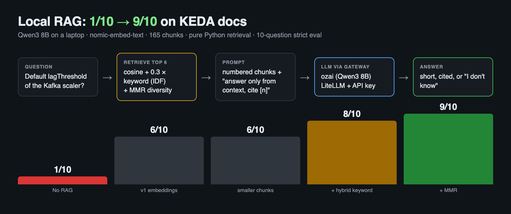

# RAG Took My Local LLM From 1/10 to 9/10. The Last Bugs Weren't the Model.

*From DevOps to AI Platform Engineering — Part 3*

In [part 1](https://dev.to/ozy31/i-built-a-self-hosted-chatgpt-on-my-laptop-heres-what-broke-2gci) I built **OzAI**, a self-hosted LLM platform on a MacBook Pro M1 Pro (16 GB): Ollama for the models, a LiteLLM gateway with API keys, and Open WebUI. In [part 2](https://dev.to/ozy31/your-llm-returns-200-ok-and-still-fails-how-i-monitor-a-self-hosted-model-16il) I added a Grafana dashboard and load tested it.

Part 1 ended with a problem I couldn't fix with infrastructure. I asked OzAI for the default `lagThreshold` of KEDA's Kafka scaler. The answer is **10**. OzAI said **1000**, with total confidence.

This part is about fixing that with **RAG**, and about measuring the fix. The headline is in the title, but the more useful part is how I got the diagnosis of the last failures wrong, and what the right diagnosis was.



---

## RAG in one paragraph

An 8B model squeezes a lot of the internet into 5 GB of weights. Details get blurry, and anything newer than its training data is simply missing. **Retrieval-Augmented Generation** turns a closed-book exam into an open-book one: before the model answers, you search your own documents, put the most relevant passages into the prompt, and tell the model to answer *only* from them and cite them. The model doesn't change. What changes is what's in front of it.

```
question ──► embed ──► find closest chunks ──► [chunks + question] ──► LLM ──► answer with [1] citations
```

## No framework, on purpose

LangChain or LlamaIndex would do this in ten lines. I wanted to see every moving part, so `rag/ozai_rag.py` uses only the Python standard library, about 160 lines:

- **Documents:** 10 pages of the KEDA 2.22 docs (concepts plus 7 scalers), about 17,000 words of Markdown.
- **Embeddings:** `nomic-embed-text`, running in the same Ollama that serves the chat models.
- **Vector search:** cosine similarity in a Python loop. With 165 chunks of 768 numbers each, a loop is instant. A vector database starts to make sense at hundreds of thousands of chunks, not hundreds.
- **Generation:** the `ozai` model (Qwen3 8B, thinking off) through the same LiteLLM gateway, with its own API key. So RAG traffic shows up on the part 2 dashboard like any other client.

Two details mattered more than I expected.

**1. Keep the heading in every chunk.** A chunk that says `default: 10` is useless if you don't know which scaler it belongs to. Every chunk starts with its file and heading:

```python
chunks.append({
    "source": f"{title} > {heading}",
    "text": f"[{title} > {heading}] {piece}",   # e.g. [scalers_apache-kafka > Trigger Specification] ...
})
```

**2. Embedding models can have instructions too.** `nomic-embed-text` expects a prefix: `search_document:` for the chunks you index and `search_query:` for the question. The model's documentation says to use them. Without them, the vectors are still produced and nothing errors, so you'd never notice. (If you've read parts 1 and 2, you know this pattern by now.)

---

## Eval first: 10 questions, strict scoring

Before writing the retrieval code, I wrote the test. Ten questions about KEDA, each with the terms a correct answer *must* contain:

```json
{"q": "What is the default lagThreshold of the KEDA Apache Kafka scaler?", "expect": ["\\b10\\b"]},
{"q": "Which SASL modes does the KEDA Apache Kafka scaler support?",
 "expect": ["scram_sha256", "scram_sha512", "oauthbearer", "gssapi"]}
```

An answer passes only if every pattern matches. It's crude: it can't judge style, and a lucky number could pass. But it's objective and repeatable, and it turns "RAG feels better" into a number. Running it is one command: `python3 rag/ozai_rag.py eval rag/eval_keda.json`. Each question is asked twice, without RAG and with RAG, at temperature 0.

## Baseline: 1/10

Without RAG, the model got one question right. The wrong answers weren't "I don't know." They were detailed, formatted, confident and invented:

- Kafka `lagThreshold` default: **1000** (docs: 10).
- RabbitMQ `mode` values: **`pull` (default)**, and more. That mode doesn't exist. The real ones are `QueueLength`, `MessageRate` and others.
- Cron scaler parameters: **`schedule` (required)**. The real parameters are `timezone`, `start`, `end` and `desiredReplicas`.

This is the dangerous kind of wrong. It looks exactly like a right answer.

## v1: 6/10

The first RAG version used 300-word chunks and put the top 4 into the prompt. Accuracy went from 1 to 6.

The behavior changed too. When the context didn't contain the answer, the model said so:

> The `lagThreshold` in the KEDA Apache Kafka scaler is not explicitly mentioned in the provided context. Therefore, I don't know.

For a platform, an honest "I don't know" is a huge improvement over an invented answer.

The four failures had a common cause: the **right page, but the wrong chunk**. The chunk with the actual parameter list wasn't in the top 4.

## Smaller chunks: still 6/10

The obvious fix was smaller chunks (150 words) and more of them (top 6). Retrieval looked different, but the score didn't move. I'm including this because it's tempting to skip the experiments that didn't work. This one told me the problem wasn't granularity.

## Hybrid search: 8/10

Look at the questions again: `lagThreshold`, `mode`, `protocol`, `listLength`. They contain **exact identifiers**. Embeddings capture meaning well, but they're weak at "this exact token must appear." Classic keyword search is the opposite.

So I added a keyword score: the share of the question's terms that appear in a chunk, weighted by how rare each term is (IDF, so `lagThreshold` counts much more than `scaler`). The final score is `cosine + 0.3 × keyword`:

```python
def keyword_scores(question, chunks):
    terms = {t.lower() for t in re.findall(r"[A-Za-z_][A-Za-z0-9_]{2,}", question)} - STOPWORDS
    texts = [c["text"].lower() for c in chunks]
    idf = {t: math.log(len(texts) / (1 + sum(t in x for x in texts))) + 1 for t in terms}
    total = sum(idf.values()) or 1
    return [sum(w for t, w in idf.items() if t in x) / total for x in texts]
```

That gave **8/10**. Search engines have combined these two signals for years. For technical documentation full of parameter names, it's not optional.

---

## The last two failures: my wrong diagnosis

Both remaining failures were RabbitMQ questions:

- *What are the possible values of `mode`?* The model listed 2 or 3 of the 5.
- *Which protocols are accepted, and which is the default?* The model said **HTTP**. The docs say **`auto`**.

The model's own answer even explained itself: *"The default protocol is HTTP, as indicated by the examples in the context."* I read that, decided the model had the facts and reasoned badly, and wrote it into my notes: **"Remaining 2 failures are model reasoning, not retrieval."**

If it's a reasoning problem, the fix is a model that reasons more. Qwen3 has a thinking mode, exposed on my gateway as `ozai-think`, so I tried that on both questions:

```
Model        mode question      protocol question
ozai         wrong, 17 s        wrong, 21 s
ozai-think   wrong, 27 s        wrong, 41 s
```

Slower and still wrong. (One gotcha from part 1 came back here: my script capped answers at 400 tokens, and a thinking model can spend that whole budget thinking and return an empty answer. I made the cap configurable before running this test, or it wouldn't have meant anything.)

Then I did what I should have done first: **I printed the six chunks the model actually received.**

```
1  scalers_rabbitmq-queue > AMQP protocol
2  scalers_rabbitmq-queue > HTTP protocol (with `QueueLength` trigger)
3  scalers_rabbitmq-queue > HTTP protocol (with `QueueLength` trigger)
4  scalers_rabbitmq-queue > HTTP protocol (with `ExpectedQueueConsumptionTime` trigger)
5  scalers_rabbitmq-queue > HTTP protocol (with `MessageRate` and `QueueLength` triggers)
6  scalers_rabbitmq-queue > AMQP protocol with username and password authorization
```

Every one of them is a YAML **example**. The section that actually lists the five modes and says `Default value is auto`, *Trigger Specification*, wasn't there. It ranked between **14th and 30th**.

The model hadn't reasoned badly. It had been handed six examples, most of them using HTTP, and made a sensible guess. No amount of thinking can recover a fact that isn't in the context. **The failures were retrieval failures all along.** My notes were wrong, and I corrected them in the repo.

### Why the examples won

The RabbitMQ page has **eleven** configuration examples. Every one contains the words `mode`, `protocol` and `RabbitMQ`, so every one scores well on both embeddings and keywords. They're also nearly identical to each other. Together they push the one paragraph with the answer out of the top 6.

## MMR: 9/10

The standard fix for "the top results are all the same thing" is **Maximal Marginal Relevance (MMR)**. Instead of taking the top 6 by score, you pick them one at a time, and each pick is penalized for being similar to chunks you've already picked:

```python
pool, picked = scored[:5 * k], []
while pool and len(picked) < k:
    best = max(pool, key=lambda x: MMR * x[0]
               - (1 - MMR) * max((cosine(x[1]["vec"], p["vec"]) for p in picked), default=0))
    picked.append(best[1]); pool.remove(best)
```

With `MMR = 0.7` (70% relevance, 30% diversity), each near-copy of an example that's already picked gets pushed down a little, which is enough to make room for a chunk from a different section. I also tried simply taking more chunks (top 12, no MMR). That recovered only one of the two answers, with twice as much context.

With MMR and the same budget of 6 chunks, the `mode` question now gets all five values right, and none of the other nine questions got worse:

```
Config                                        Accuracy   Avg latency   Avg prompt tokens
No RAG (model memory)                           1/10       ~18-20 s            31
v1: 300-word chunks, top 4, embeddings          6/10        9.2 s            1264
v2a: 150-word chunks, top 6, embeddings         6/10        7.7 s               -
v2b: + hybrid keyword score                     8/10        9.9 s            1487
v3:  + MMR diversity (0.7)                      9/10       10.6 s            1413
```

Notice the latency column. **RAG answers were about twice as fast as no-RAG answers**, even with 45 times more prompt tokens. Without context, the model writes long, invented explanations. With context and an instruction to cite, it writes short answers. On hardware that serves one request at a time (part 2), shorter answers mean a shorter queue for everyone.

## The one I didn't fix

The `protocol` question still fails. The *Trigger Specification* section is split across three chunks, and MMR brings in one of them, but not the one that says `Default value is auto`. I tried a few more settings (MMR from 0.5 to 0.7, top 6 to 8). None of them got it.

So I stopped. With ten questions, every tweak that fixes one question is a tweak fitted to that question. Keep going and you're tuning the test, not the system. The honest score is 9/10, and the real fixes are structural:

- a **reranker**: a second model that reads the top 30 candidates together with the question and reorders them,
- or **structure-aware chunking**: one chunk per parameter in a parameter list, instead of fixed word counts.

One more detail from that question: with MMR, `ozai-think` still answered wrong, but this time it said *"the context does not explicitly state the default, so it is inferred."* The thinking mode didn't make the model more correct, but it made it more honest about its uncertainty. That's worth something, though it isn't worth 80 seconds per answer.

---

## Takeaways for DevOps engineers

1. **Write the eval before the pipeline.** Ten questions with strict, automatic scoring turned every change into a number. Without it, I would have kept "smaller chunks" because it *felt* better.
2. **When a RAG answer is wrong, print the retrieved chunks before blaming the model.** I skipped this step and wrote down a wrong conclusion. It's the RAG version of "check the logs before you restart the service."
3. **Exact identifiers need keyword search.** Technical docs are full of names like `lagThreshold`. Embeddings alone miss them.
4. **Near-duplicate content crowds out the answer.** Examples, changelogs and templates all look alike. Diversity in retrieval (MMR) matters as much as relevance.
5. **Stop tuning before you overfit a small test set.** At some point the next fix is a better method, not a better parameter.

## Next: part 4

Everything so far runs on a laptop, serves one request at a time, and uses an 8B model. In part 4 I move OzAI to **Amazon EKS with GPU nodes**, replace Ollama with **vLLM** and its continuous batching, autoscale on queue depth with **KEDA** (yes, the same KEDA from this article's test set), and run the load test from part 2 again. I'll also compare the cost of all this with paying per token.

All code, the eval set and every result file are in the repo: **[github.com/ozy31/self-hosted-llm-platform](https://github.com/ozy31/self-hosted-llm-platform)**
