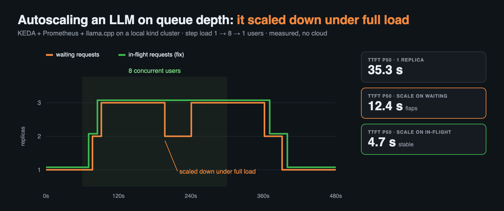

*From DevOps to AI Platform Engineering — Part 4*

In [part 1](https://dev.to/ozy31/i-built-a-self-hosted-chatgpt-on-my-laptop-heres-what-broke-2gci) I built **OzAI**, a self-hosted LLM platform on a MacBook Pro M1 Pro. In [part 2](https://dev.to/ozy31/your-llm-returns-200-ok-and-still-fails-how-i-monitor-a-self-hosted-model-16il) I added monitoring and a load test. In [part 3](https://dev.to/ozy31/rag-took-my-local-llm-from-110-to-910-the-last-bugs-werent-the-model-1df6) RAG took it from 1/10 to 9/10 correct answers.

Part 3 ended with a promise: move OzAI to Amazon EKS with GPU nodes, serve it with vLLM, and autoscale on queue depth with KEDA.

I'm going to keep half of that promise, and I want to be upfront about which half.

**What I didn't do:** I didn't run GPUs on AWS for this article. So there are **no measured vLLM or GPU numbers here.** Any GPU number below is labeled as an estimate or a formula.

**What I did do:** the autoscaling logic is the part that breaks in production, and it doesn't need a GPU to test. So I built the same scaling chain in a local Kubernetes cluster and load tested it three times. The second run found a bug in my own design. The third run fixed it.



---

## The design I wanted to test

I already have a Terraform repo for the EKS version: [terraform-aws-eks-ai-cluster](https://github.com/ozy31/terraform-aws-eks-ai-cluster). Karpenter launches GPU nodes, model weights are mounted from S3, vLLM serves the model, and KEDA scales the vLLM Deployment on this Prometheus query:

```promql
sum(vllm:num_requests_waiting{model_name="qwen3-8b"})
```

The idea is common and, I think, right: **for LLM serving, CPU and GPU utilization are bad scaling signals.** A GPU running vLLM shows high utilization whether it serves 2 users or 20. What users feel is *waiting*. So you scale on the number of requests waiting in the server's queue.

`terraform validate` passes. That proves the HCL is valid, not that the scaling works.

## The local lab

Everything runs in [kind](https://kind.sigs.k8s.io/) (Kubernetes in Docker) on the laptop. Docker gets 8 vCPUs and 8 GB.

| EKS design | Local lab |
|---|---|
| vLLM on an NVIDIA GPU | llama.cpp server on CPU |
| `vllm:num_requests_waiting` | `llamacpp:requests_deferred` |
| Qwen3 8B | Qwen2.5 0.5B (Q4), so 3 replicas fit in 8 GB |
| Karpenter adds GPU nodes | one node, pods only |
| Weights from S3 via Mountpoint | weights from a host folder |
| kube-prometheus-stack | Prometheus server only, 5s scrape |
| KEDA ScaledObject | the same ScaledObject, shorter windows |

Why llama.cpp instead of vLLM? vLLM is built for NVIDIA GPUs. For this test I need two behaviors from the server, and llama.cpp has both:

1. **Parallel slots with continuous batching** (`--parallel 2`): each pod serves 2 requests at once, and more requests queue inside the pod.
2. **A queue metric in Prometheus format** (`--metrics`): `requests_processing` and `requests_deferred` (waiting).

Each pod gets 2 CPUs and 2 slots, with min 1 and max 3 replicas. Here is the ScaledObject. Production waits 2 minutes between scale-ups and 10 minutes before scaling down, because each replica is a GPU node. I shortened those windows so a run fits in 8 minutes:

```yaml
spec:
  scaleTargetRef: {name: ozai-lab}
  minReplicaCount: 1
  maxReplicaCount: 3
  advanced:
    horizontalPodAutoscalerConfig:
      behavior:
        scaleUp:
          policies: [{type: Pods, value: 1, periodSeconds: 15}]
        scaleDown:
          stabilizationWindowSeconds: 60
          policies: [{type: Pods, value: 1, periodSeconds: 30}]
  triggers:
    - type: prometheus
      metadata:
        serverAddress: http://prometheus-server.monitoring.svc:80
        query: sum(llamacpp:requests_deferred{namespace="ozai"}) or vector(0)
        threshold: "2"
```

The load test is a step load: **1 user for 60 s, then 8 users for 240 s, then 1 user for 180 s.** Each user sends the same streamed request as in part 2 (128 tokens max), and starts the next one as soon as the previous one finishes. Every 2 seconds a sampler records the replica count and the queue size from Prometheus.

## Run 1: no autoscaling

First, a baseline with KEDA paused at one replica (the `autoscaling.keda.sh/paused-replicas: "1"` annotation).

With 1 user, time to first token (TTFT) is **0.05 s** and the model generates **22 tokens/s**. That's what one user sees when the platform is idle.

With 8 users, 2 requests are served and 6 wait. **TTFT p50 is 35 s.** No request failed. All of them were just slow. As in part 2, the platform returns `200 OK` while users wait half a minute for the first word.

## Run 2: autoscaling on waiting requests

Same load with KEDA on:

- The queue grew to 6 waiting requests. KEDA asked for a 2nd replica about **17 s** after the load started, and a 3rd about **32 s** after.
- Each new pod was ready in about **2 s**, because the model is 0.5B and already on local disk. On EKS this is the expensive part, more on that below.
- TTFT p50 dropped from 35 s to **12 s**. Completed requests went from 48 to 83.

Then I looked at the replica timeline:

```
t=  77s  desired=2  ready=1   waiting=6    <- 8 users arrive at t=60
t=  92s  desired=3  ready=2
t= 197s  desired=2  ready=2   waiting=4    <- scaled DOWN with 8 users still active
t= 241s  desired=3  ready=2   waiting=6    <- and back up
t= 362s  desired=2                         <- load is over
```

**The autoscaler removed a replica in the middle of full load,** ran with 2 replicas for about 44 s, and then added the replica back.

## Why it scaled down: the metric is measuring its own fix

KEDA's Prometheus scaler gives the HPA a target average value, so desired replicas are roughly:

```
desired = ceil(metric / threshold)
```

Put the numbers in:

- 1 pod, 8 users: 2 processing, **6 waiting**. `ceil(6 / 2) = 3`. Scale up. Correct.
- 3 pods, 8 users: 6 processing, **2 waiting**. `ceil(2 / 2) = 1`. **Scale down.**

Adding replicas moves requests from *waiting* to *processing*, and waiting goes down. To a metric that only counts waiting requests, a fix looks the same as the load going away. Once the 60 s stabilization window passes, the HPA removes a pod. The queue grows again and the pod comes back.

The production chart in my Terraform repo has the same flaw. Its 10-minute scale-down window hides it, because the dip has to last 10 minutes before anything happens. But the flaw is still there, and with GPU nodes each flap could mean another node launch.

## The fix: scale on requests in flight

The question the autoscaler needs to answer is "how many replicas does this many requests need?", not "is anyone waiting?". So the metric should be **all requests in the system**, processing plus waiting, and the threshold should be **one pod's capacity**:

```yaml
query: sum(llamacpp:requests_processing{namespace="ozai"} + llamacpp:requests_deferred{namespace="ozai"}) or vector(0)
threshold: "2"   # = --parallel slots per pod
```

Now 8 users means 8 in flight and `ceil(8 / 2) = 4`, capped at 3. Scaling up doesn't change the number, so it doesn't undo itself.

For vLLM, the equivalent is `vllm:num_requests_running + vllm:num_requests_waiting`. The threshold is the number of requests one replica can run at a good speed, which you get from a load test, not from `--max-num-seqs`.

## Run 3: in-flight metric

| 8-user phase | Baseline (1 replica) | Waiting metric | In-flight metric |
|---|---|---|---|
| Requests completed | 48 | 83 | **97** |
| Output tokens/s (all users) | 25.4 | 44.3 | **51.7** |
| TTFT p50 | 35.3 s | 12.4 s | **4.7 s** |
| TTFT p95 | 35.6 s | 36.5 s | 35.9 s |
| TTFT p50 / p95 after scale-up | – | 12.4 s / 35.5 s | **0.95 s / 23.9 s** |
| Scale-down during load | – | yes | **no** |
| Errors | 0 | 0 | 0 |

The in-flight metric scaled up faster (2nd replica at about 11 s, 3rd at about 25 s), stayed at 3 replicas for the whole load, and scaled back to 1 about 100 s after the load ended.

## What autoscaling did not fix

Look at TTFT p95: **about 36 s in every run**, autoscaling or not. Two reasons, and both apply to vLLM too.

**1. Queued requests don't move to new pods.** When the 8 users arrived, the Service had already sent 8 requests to the one pod: 2 running and 6 queued inside the llama.cpp process. New pods only receive *new* requests. The 6 queued ones waited on the old pod as if scaling never happened. On EKS, where a new replica takes minutes to start instead of 2 seconds, the requests that arrive at the start of a spike wait even longer. Autoscaling protects the next requests, not the current ones.

**2. maxReplicas is a capacity limit, and it shows up in latency.** 8 users need 4 pods of 2 slots each. Max was 3, so 2 requests were always waiting, which is why p95 stayed at 24 s even after scale-up. In production that limit is your budget (`maxReplicas`, Karpenter's `gpu_limit`, your GPU quota). Set it from a load test, not by guessing.

## A result I didn't expect: batching on CPU added almost no throughput

With 1 user, the pod made 23.5 tokens/s. With 2 slots busy, it made **25.4** tokens/s in total, and each user got **11** instead of 22. On this CPU setup, a second slot mostly splits the same speed between two people.

That is **not** what vLLM does on a GPU. During decoding, a GPU spends most of its time reading model weights from memory, so batching more requests into the same weight read is close to free, up to a point. That is the reason to use vLLM on a GPU. But it also means **my laptop numbers can't be scaled up to a GPU estimate**, so I won't do it. The scaling *logic* carries over to EKS. The throughput numbers don't.

## What the lab can't show

Things that matter on EKS that I didn't measure:

- **Cold start.** Here a new replica was ready in 2 s. On EKS: Karpenter launches a GPU instance, the node joins, a multi-GB vLLM image is pulled, 16 GB of Qwen3 8B weights stream from S3, and the GPU warms up. That's minutes, not seconds, and it's the reason the production chart adds one pod every 2 minutes. I haven't measured it, so I won't give you a number.
- **Scale to zero.** With 0 replicas, vLLM exports no metrics, so a queue trigger can never fire. The chart has an optional `wakeQuery` on gateway traffic for this. Not tested here.
- **A setting in my own chart that does nothing.** KEDA warned on apply: *"CooldownPeriod is only relevant when minReplicaCount = 0 or idleReplicaCount is set."* My EKS chart sets `cooldownSeconds: 900` with `minReplicas: 1`, so that setting is ignored. Scale-down speed comes from the HPA `behavior` block. You only see this warning when you apply the manifest to a real cluster, even a local one, and `terraform validate` will never show it.

## Cost: a formula, not a benchmark

I didn't measure GPU throughput, so here is the math to use once you have it. An NVIDIA L4 instance (`g6.xlarge`, 1 GPU, 24 GB) is **$0.8048/hour** on-demand in us-east-1 at the time of writing. Spot is often less than half that, but it changes by zone and by hour.

```
cost per 1M output tokens = hourly price / (tokens per second × 3600) × 1,000,000
```

| Average output throughput across the hour (hypothetical) | On-demand $/1M tokens |
|---|---|
| 100 tokens/s | $2.24 |
| 500 tokens/s | $0.45 |
| 1,000 tokens/s | $0.22 |

The key word is **average**. A GPU's peak throughput doesn't matter if it's idle most of the hour. With `minReplicas: 1`, one L4 running 24/7 costs about **$588/month** on-demand, even if nobody sends a request. For a small team the real cost question is usually not "how fast is vLLM?" but "how many hours a day is the GPU busy?". That's why scale-to-zero and spot instances matter more than the last 10% of tokens per second.

## Takeaways

1. **Scale LLM servers on requests in flight per replica, not on waiting requests alone.** A waiting-only metric goes down when scaling works, and the autoscaler removes the capacity it just added.
2. **Autoscaling doesn't help the requests already queued.** Their latency depends on how fast new capacity arrives, which on GPUs is minutes. Keep a warm minimum, or accept slow first requests in a spike.
3. **maxReplicas is a latency decision.** If it's too low, p95 stays bad no matter how good the scaling metric is.
4. **Test the scaling logic locally.** It cost nothing, took an afternoon, and found two problems in a design that had already passed `terraform validate` and CI.
5. **Don't reuse laptop throughput numbers for GPU estimates.** Batching works differently on CPU and GPU.

## Run it yourself

```bash
kind create cluster --config k8s-lab/kind.yaml   # mounts k8s-lab/models into the node
helm --kube-context kind-ozai-lab upgrade -i prometheus prometheus-community/prometheus \
  -n monitoring --create-namespace -f k8s-lab/prometheus-values.yaml
helm --kube-context kind-ozai-lab upgrade -i keda kedacore/keda -n keda --create-namespace
kubectl --context kind-ozai-lab apply -f k8s-lab/inference.yaml -f k8s-lab/scaledobject-inflight.yaml
python3 k8s-lab/loadtest.py result.json 60:1,240:8,180:1   # needs Prometheus port-forwarded to :9090
```

## Where this leaves the series

This is the last planned part. Over four parts, OzAI went from one model on a laptop to a gateway with keys and limits, a dashboard that catches slow `200 OK` responses, RAG that answers from documents, and an autoscaling design tested under load.

The one thing still missing is real GPU numbers: cold start time, vLLM throughput on an L4, and real cost per million tokens. When I run it on EKS, it will get its own short post with only measured numbers.

All code, manifests and raw results are in the repo: **[github.com/ozy31/self-hosted-llm-platform](https://github.com/ozy31/self-hosted-llm-platform)**
